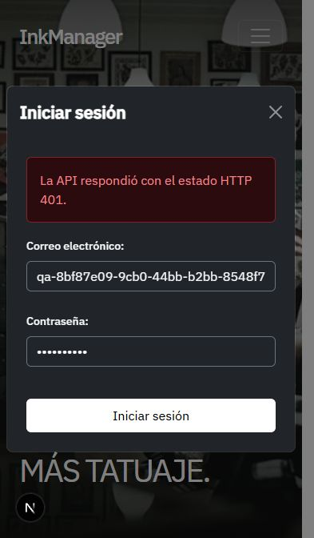

**Informe de pruebas de InkManager — 22/10/2026**

Este documento conserva el diagnóstico previo. Las soluciones y sus verificaciones
están en [correcciones de acceso y registro](qa-correcciones-2026-10-22.md).

Rama: `autenticacion`. Commit de referencia: `6ed14cd`. Se probó además el frontend modificado que todavía no está commiteado, incluida la conversión a TypeScript y la conexión del modal de login.

**Resultado**

129 comprobaciones funcionales: **112 correctas y 17 fallidas o pendientes**. Son resultados de comprobaciones, no 17 problemas independientes: varios casos prueban distintas manifestaciones del mismo problema.

| Área | Correctas | Fallidas / pendientes | Total |
|---|---:|---:|---:|
| Backend, persistencia, archivos y fallos simulados | 91 | 8 | 99 |
| Navegador e interfaz | 21 | 9 | 30 |
| Total | 112 | 17 | 129 |

El login del navegador, la persistencia de la cookie y la revocación de sesiones funcionan. El registro desde la interfaz todavía no se completa y la interfaz autenticada está pendiente.

**Comprobaciones técnicas**

| Comando | Resultado |
|---|---|
| Back: `npm.cmd run build` | Correcto |
| Front: `npm.cmd run typecheck` | Correcto |
| Front: `npm.cmd run lint` | Correcto |
| Front: `npm.cmd run build` | Correcto |
| Front: `npm.cmd run format:check` | Falla: 27 archivos requieren formato |

**Hallazgos y orden recomendado**

| Prioridad | Hallazgo | Evidencia y ubicación | Cambio recomendado |
|---|---|---|---|
| Alta | Registro del frontend incompatible con el backend | El formulario envía `name`, `roles` y valores `CLIENT/ARTIST/STUDIO` a `/auth/register-artist`. El backend espera `nombre`, `rol` y `CLIENTE/ARTISTA/ESTUDIO_ADMIN` en el registro general. La petición devuelve 400 y no crea la cuenta. [Servicio](../Front/src/services/users.service.ts), [registro](../Front/src/app/(auth)/Register/Register.tsx). | Conectar el alta básica a `/auth/register` y mapear sus campos. Completar el perfil con un flujo separado según el rol. |
| Alta | El registro antiguo evita las validaciones del registro general | `/auth/register-artist` acepta una contraseña de tres caracteres y un email sin formato válido con 201. Un `nombreArtistico` numérico produce 500. [Servicio](../Back/src/usuarios/usuarios.service.ts). | Reutilizar validaciones en ambos endpoints o retirar el endpoint antiguo una vez adaptada la interfaz. |
| Alta / pendiente de política | Las restricciones de acceso aún no están aplicadas a los recursos | `requerirRoles` pasó la matriz de permisos en rutas temporales, pero no está conectado a rutas de la aplicación. La subida de PNG respondió 200 sin sesión. [Rutas de imágenes](../Back/src/imagenes/imagenes.routes.ts), [roles](../Back/src/middlewares/roles.ts). | Definir qué acciones requieren sesión y qué roles pueden ejecutarlas. Aplicar los middlewares antes de procesar archivos y otros recursos protegidos. |
| Funcional pendiente | El frontend no representa la sesión iniciada | Tras un login correcto y una recarga, `/me` devuelve al usuario en el navegador, pero el menú sigue mostrando Login/Register. No ofrece logout. La Home solo tiene las dos entradas a clientes y estudios; los modales están en estudios. | Agregar estado de sesión, recuperación mediante `/me`, logout y accesos desde la Home. |
| Media | Errores de archivos y JSON no tienen una respuesta uniforme | Archivo mayor de 5 MB: 500 HTML, aunque el tamaño sí se bloquea. Campo de archivo incorrecto: 500 HTML. JSON malformado: 400 HTML. [Multer](../Back/src/middlewares/multer.ts), [app](../Back/src/app.ts). | Traducir los errores de Multer y del parser a respuestas JSON. Usar 413 para tamaño y 400 para el campo incorrecto. |
| Media | El registro no muestra su error | El modal permanece abierto sin informar el 400. Se llama a `toast.error`, pero no hay un `ToastContainer` en la aplicación. | Montar el contenedor de mensajes o mostrar el error dentro del formulario. |
| Media | Validaciones de formularios pendientes | Se puede avanzar con campos obligatorios vacíos y llegar al último paso de artista sin nombre artístico. Los inputs de email son de tipo text. | Definir validación por campo y por paso, conservando la validación del backend. |
| Media | El envío del login puede repetirse mientras espera | El botón sigue habilitado durante la solicitud. [Formulario](../Front/src/components/forms/FormikForm.tsx). | Usar `isSubmitting` de Formik para deshabilitar el envío y mostrar su estado. |
| Media | Etiquetas sin asociación a los inputs | Los labels tienen `htmlFor`, pero los campos de texto y select no tienen el `id` correspondiente. El navegador informa cero labels asociados en login y registro. | Agregar IDs coherentes y autocompletado apropiado. |
| Menor | Mensaje de login demasiado técnico | Las credenciales incorrectas muestran “La API respondió con el estado HTTP 401.” en lugar del mensaje del backend. [Cliente HTTP](../Front/src/lib/api-client.ts). | Conservar el código HTTP y presentar el mensaje de error del backend. |
| Menor | Formato inconsistente | Prettier informa 27 archivos. | Formatear en un cambio separado para mantener legible la revisión funcional. |

**Lo que pasó en autenticación y sesiones**

- Registro general de cliente, artista y administrador de estudio; creación y relación del estudio; hash de contraseña; duplicados y altas concurrentes.
- Rechazo de SUPERADMIN y roles desconocidos en el registro público. Los campos privilegiados enviados como extras se ignoran.
- Login con los tres roles públicos, normalización del email y rechazo uniforme de credenciales incorrectas.
- Cookie HttpOnly, SameSite=Lax, Path=/ y duración de una hora; Secure cuando el proceso se configura para producción.
- JWT alterado, malformado, vencido, sin firma, sin jti, con issuer/audience incorrectos o con HS512: rechazados.
- Sesiones inexistentes, ajenas, vencidas o revocadas en la base: rechazadas aunque el JWT esté firmado y vigente.
- Cambio del rol en la base reflejado sin volver a iniciar sesión. La eliminación del usuario revoca su acceso.
- Logout revoca en la base, borra la cookie y rechaza la reutilización del token anterior; otras sesiones siguen activas.
- Logout repetido, sin cookie o con token vencido. Origen ajeno rechazado sin revocar la sesión.
- Restricción de intentos: cinco fallos y luego 429 con Retry-After.
- CORS para el frontend y cabeceras no-store en respuestas personales.
- RLS activado en Sesion. Fallos de BD y Cloudinary devuelven los estados controlados previstos sin exponer el error simulado.
- Verificación de email: tokens vacíos, ausentes, repetidos como array e inexistentes se rechazan; el token válido marca el email como verificado, se elimina y no puede reutilizarse. Se comprobó la persistencia en la base y el manejo de un fallo simulado de BD. La cuenta adicional de esta prueba también se eliminó.

**Método, alcance y limpieza**

Las pruebas de API usaron el backend compilado en procesos y puertos locales temporales, con PostgreSQL de Supabase y Cloudinary reales. Las rutas QA para comprobar roles se agregaron únicamente en memoria a ese proceso: **no son endpoints nuevos del proyecto**. Los fallos de almacenamiento se simularon únicamente en un proceso de pruebas; no se interrumpieron los servicios reales.

Las pruebas del navegador usaron el frontend en `127.0.0.1:3001` y el backend en `127.0.0.1:4000`. Se verificó el viewport móvil existente, navegación Home/clientes/estudios, formularios, cookie real, reseñas, planes y acordeón. Los planes quedaron centrados y sin desbordamiento horizontal. Sus botones conservan el comportamiento sin navegación solicitado para la demo.

Se eliminaron todas las cuentas y sesiones creadas por esta ejecución, el estudio temporal y la imagen de Cloudinary. La comprobación final encontró **cero usuarios y cero sesiones temporales restantes**. Los manifiestos temporales con credenciales también se eliminaron. No se modificó la implementación durante estas pruebas, no se hicieron commits ni pushes y no se cambiaron ramas.

No se ejecutó la suite antigua `Back/tests/endpoints.test.ts`: todavía usa mocks desactualizados y espera 404 en endpoints de autenticación que ahora existen. No hay script `npm test` configurado en el backend. Las comprobaciones temporales de esta ejecución no reemplazan una suite de regresión versionada.

No se evaluaron carga masiva, dispositivos físicos, otros navegadores, despliegue HTTPS ni funcionalidades ausentes como Google o envío real de correo. La verificación de email se probó mediante su endpoint y la base, sin enviar mensajes. Se revisó el formato de la configuración de cookies de producción, sin simular un despliegue real.

**Evidencia visual**

**Detalle completo del backend**

| Comprobación | Resultado | Evidencia |
|---|---|---|
| Health | Correcto | Comprobado durante la ejecución |
| Sin cookie requiere sesion | Correcto | Comprobado durante la ejecución |
| Registro CLIENTE | Correcto | Comprobado durante la ejecución |
| Registro ARTISTA | Correcto | Comprobado durante la ejecución |
| Registro ESTUDIO_ADMIN | Correcto | Comprobado durante la ejecución |
| Email duplicado | Correcto | Comprobado durante la ejecución |
| Rol SUPERADMIN publico | Correcto | Comprobado durante la ejecución |
| Rol desconocido | Correcto | Comprobado durante la ejecución |
| Email invalido | Correcto | Comprobado durante la ejecución |
| Password corta | Correcto | Comprobado durante la ejecución |
| Password mas de 72 bytes | Correcto | Comprobado durante la ejecución |
| Nombre vacio | Correcto | Comprobado durante la ejecución |
| Artista sin nombre artistico | Correcto | Comprobado durante la ejecución |
| Estudio sin nombre | Correcto | Comprobado durante la ejecución |
| Nombre demasiado largo | Correcto | Comprobado durante la ejecución |
| Registro rechaza array | Correcto | Comprobado durante la ejecución |
| Registro rechaza null | Correcto | Comprobado durante la ejecución |
| Login CLIENTE | Correcto | Comprobado durante la ejecución |
| Login ARTISTA | Correcto | Comprobado durante la ejecución |
| Login ESTUDIO_ADMIN | Correcto | Comprobado durante la ejecución |
| Cookie HttpOnly SameSite Path y vencimiento | Correcto | Comprobado durante la ejecución |
| Sesion persistida activa | Correcto | Comprobado durante la ejecución |
| Respuestas personales no cacheables | Correcto | Comprobado durante la ejecución |
| Login normaliza email | Correcto | Comprobado durante la ejecución |
| Login ignora rol enviado en body | Correcto | Comprobado durante la ejecución |
| Password incorrecta y cuenta inexistente mismo error | Correcto | Comprobado durante la ejecución |
| Login vacio | Correcto | Comprobado durante la ejecución |
| Login email invalido | Correcto | Comprobado durante la ejecución |
| Login exige JSON | Correcto | Comprobado durante la ejecución |
| Login rechaza Origin ajeno | Correcto | Comprobado durante la ejecución |
| CORS permite frontend y credenciales | Correcto | Comprobado durante la ejecución |
| CORS no autoriza Origin ajeno | Correcto | Comprobado durante la ejecución |
| Token malformado | Correcto | Comprobado durante la ejecución |
| Token expirado | Correcto | Comprobado durante la ejecución |
| Issuer incorrecto | Correcto | Comprobado durante la ejecución |
| Audience incorrecta | Correcto | Comprobado durante la ejecución |
| Algoritmo HS512 | Correcto | Comprobado durante la ejecución |
| Token sin jti | Correcto | Comprobado durante la ejecución |
| Token sin firma | Correcto | Comprobado durante la ejecución |
| Firma alterada | Correcto | Comprobado durante la ejecución |
| Sesion inexistente | Correcto | Comprobado durante la ejecución |
| Sesion de otro usuario | Correcto | Comprobado durante la ejecución |
| Sesion vencida en BD con JWT vigente | Correcto | Comprobado durante la ejecución |
| Sesion revocada en BD con JWT vigente | Correcto | Comprobado durante la ejecución |
| Rol actualizado en BD se refleja sin nuevo login | Correcto | Comprobado durante la ejecución |
| Middleware de roles exige sesion | Correcto | Comprobado durante la ejecución |
| Roles CLIENTE accede a CLIENTE | Correcto | Comprobado durante la ejecución |
| Roles CLIENTE accede a ARTISTA | Correcto | Comprobado durante la ejecución |
| Roles CLIENTE accede a ESTUDIO_ADMIN | Correcto | Comprobado durante la ejecución |
| Roles CLIENTE accede a SUPERADMIN | Correcto | Comprobado durante la ejecución |
| Roles ARTISTA accede a CLIENTE | Correcto | Comprobado durante la ejecución |
| Roles ARTISTA accede a ARTISTA | Correcto | Comprobado durante la ejecución |
| Roles ARTISTA accede a ESTUDIO_ADMIN | Correcto | Comprobado durante la ejecución |
| Roles ARTISTA accede a SUPERADMIN | Correcto | Comprobado durante la ejecución |
| Roles ESTUDIO_ADMIN accede a CLIENTE | Correcto | Comprobado durante la ejecución |
| Roles ESTUDIO_ADMIN accede a ARTISTA | Correcto | Comprobado durante la ejecución |
| Roles ESTUDIO_ADMIN accede a ESTUDIO_ADMIN | Correcto | Comprobado durante la ejecución |
| Roles ESTUDIO_ADMIN accede a SUPERADMIN | Correcto | Comprobado durante la ejecución |
| Roles SUPERADMIN accede a CLIENTE | Correcto | Comprobado durante la ejecución |
| Roles SUPERADMIN accede a ARTISTA | Correcto | Comprobado durante la ejecución |
| Roles SUPERADMIN accede a ESTUDIO_ADMIN | Correcto | Comprobado durante la ejecución |
| Roles SUPERADMIN accede a SUPERADMIN | Correcto | Comprobado durante la ejecución |
| Logout origen ajeno no revoca sesion | Correcto | Comprobado durante la ejecución |
| Logout revoca y borra cookie | Correcto | Comprobado durante la ejecución |
| Reutilizacion de cookie revocada | Correcto | Comprobado durante la ejecución |
| Otra sesion permanece activa | Correcto | Comprobado durante la ejecución |
| Logout repetido | Correcto | Comprobado durante la ejecución |
| Logout sin cookie | Correcto | Comprobado durante la ejecución |
| Logout con token expirado limpia cookie | Correcto | Comprobado durante la ejecución |
| Cookie Secure en produccion | Correcto | Comprobado durante la ejecución |
| Limite de intentos HTTP 429 | Correcto | Comprobado durante la ejecución |
| Resenas publicas con formato esperado | Correcto | reseñas: 6 |
| Upload sin archivo | Correcto | Comprobado durante la ejecución |
| Upload PNG y limpieza Cloudinary | Correcto | Comprobado durante la ejecución |
| Upload de mas de 5MB devuelve 413 | Falla / pendiente | HTTP 500; esperado: 413; respuesta JSON: no |
| Upload de campo incorrecto devuelve 400 | Falla / pendiente | HTTP 500; esperado: 400; respuesta JSON: no |
| Registro con payload actual de la interfaz | Falla / pendiente | HTTP 400; esperado: 201; Los campos Email, Contraseña, Nombre y Nombre Artístico son obligatorios. |
| Usuario eliminado pierde acceso | Correcto | Comprobado durante la ejecución |
| RLS activado en Sesion | Correcto | Comprobado durante la ejecución |
| Registro antiguo rechaza password corta | Falla / pendiente | HTTP 201; esperado: 400 |
| Registro antiguo valida email | Falla / pendiente | HTTP 201; esperado: 400 |
| Registro antiguo maneja tipos invalidos | Falla / pendiente | HTTP 500; esperado: 400 |
| Registro general ignora campos privilegiados | Correcto | Comprobado durante la ejecución |
| Registro concurrente de mismo email | Correcto | HTTP 201 / 409 |
| Cuenta del intento UI creada | Falla / pendiente | esperado: 1; cuentas creadas: 0 |
| Login maneja caida de BD | Correcto | HTTP 500; esperado: 500 |
| Me maneja caida de BD | Correcto | HTTP 500; esperado: 500 |
| Logout maneja caida de BD | Correcto | HTTP 500; esperado: 500 |
| Resenas manejan caida de BD | Correcto | HTTP 503; esperado: 503 |
| Upload maneja caida de Cloudinary | Correcto | HTTP 500; esperado: 500 |
| JSON malformado devuelve error JSON | Falla / pendiente | HTTP 400; respuesta JSON: no |
| Email inicia sin verificar y con token | Correcto | Comprobado en la base |
| Verificar email exige token | Correcto | HTTP 400 |
| Verificar email rechaza token vacio | Correcto | HTTP 400 |
| Verificar email rechaza token repetido como array | Correcto | HTTP 400 |
| Verificar email rechaza token inexistente | Correcto | HTTP 404 |
| Verificar email actualiza BD y elimina token | Correcto | HTTP 200 y persistencia verificada |
| Token de email no puede reutilizarse | Correcto | HTTP 404 |
| Verificacion email maneja caida de BD | Correcto | HTTP 500 controlado |

**Detalle completo del navegador**

| Comprobación | Resultado | Evidencia |
|---|---|---|
| Menú móvil abre y muestra acceso | Correcto | Comprobado durante la ejecución |
| Login vacío muestra HTTP 400 | Correcto | Comprobado durante la ejecución |
| Login incorrecto muestra HTTP 401 y conserva modal | Correcto | Comprobado durante la ejecución |
| Login correcto cierra modal | Correcto | Comprobado durante la ejecución |
| Cookie de navegador permite consultar /me | Correcto | Comprobado durante la ejecución |
| Cookie persiste al recargar | Correcto | Comprobado durante la ejecución |
| Etiquetas de login asociadas a inputs | Falla / pendiente | Comprobado durante la ejecución |
| Bloqueo de envío durante login | Falla / pendiente | Comprobado durante la ejecución |
| Interfaz reconoce sesión y ofrece logout | Falla / pendiente | Comprobado durante la ejecución |
| Registro cliente completo desde formulario | Falla / pendiente | Comprobado durante la ejecución |
| Registro muestra el error al usuario | Falla / pendiente | Comprobado durante la ejecución |
| Etiquetas del registro asociadas a inputs | Falla / pendiente | Comprobado durante la ejecución |
| Artista recorre seis pasos y vuelve atrás | Correcto | Comprobado durante la ejecución |
| Artista exige nombre artístico antes de avanzar | Falla / pendiente | Comprobado durante la ejecución |
| Estudio llega a su cuarto paso con acción de registro | Correcto | Comprobado durante la ejecución |
| Registro bloquea avance con datos obligatorios vacíos | Falla / pendiente | Comprobado durante la ejecución |
| Cerrar y reabrir reinicia los pasos | Correcto | Comprobado durante la ejecución |
| Error de login se limpia al cerrar | Correcto | Comprobado durante la ejecución |
| Escape cierra modal | Correcto | Comprobado durante la ejecución |
| Home ofrece login y registro | Falla / pendiente | Comprobado durante la ejecución |
| Home carga sus dos imágenes principales | Correcto | Comprobado durante la ejecución |
| Home navega al catálogo de clientes | Correcto | Comprobado durante la ejecución |
| Catálogo muestra estudios y artistas | Correcto | Comprobado durante la ejecución |
| Home navega a landing de estudios | Correcto | Comprobado durante la ejecución |
| Landing muestra seis retratos de reseñas | Correcto | Comprobado durante la ejecución |
| Planes centrados en vista móvil | Correcto | Comprobado durante la ejecución |
| Sin desbordamiento horizontal en vista móvil | Correcto | Comprobado durante la ejecución |
| Acordeón de herramientas responde | Correcto | Comprobado durante la ejecución |
| Botones de planes conservan comportamiento sin navegación | Correcto | Comprobado durante la ejecución |
| Cookie del navegador deja de autorizar tras eliminar cuenta temporal | Correcto | Comprobado durante la ejecución |

Resultados estructurados: [backend](qa-backend-2026-10-22.json) y [navegador](qa-browser-2026-10-22.json).
