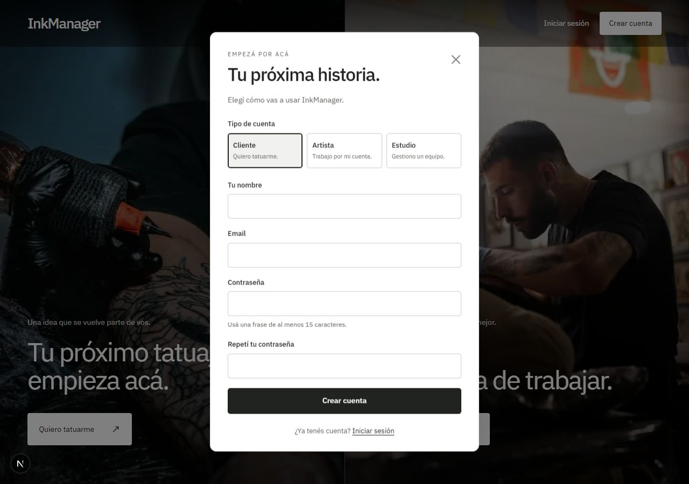
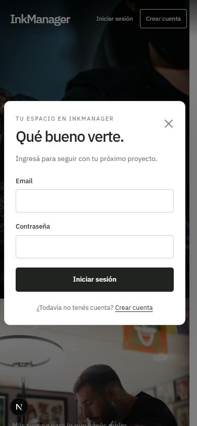
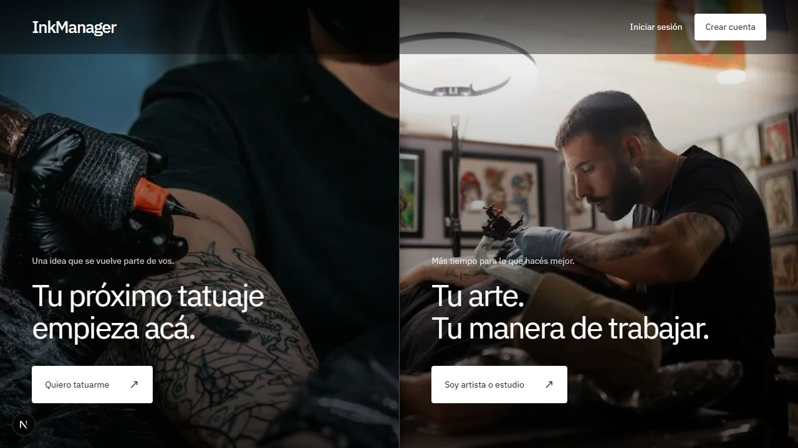

# Correcciones de acceso y registro — 22/10/2026

Rama: `autenticacion`. Cambios locales, sin commits, pushes ni merges.

Se corrigieron los problemas detectados en la [revisión anterior](qa-autenticacion-2026-10-22.md).
Ese informe conserva el estado previo; los resultados siguientes corresponden a las correcciones.

## Qué cambió

| Problema detectado | Solución |
| --- | --- |
| Registro incompatible con el backend | El formulario envía campos en español y roles válidos a `POST /api/auth/register`. |
| Formulario extenso sin validación | Alta básica por rol: nombre, email, contraseña y confirmación; artista agrega nombre artístico, estudio agrega su nombre. |
| Registro antiguo aceptaba datos inválidos | Comparte validaciones de nombre, email y contraseña; valida también enums, números, listas, URLs y opciones del perfil. Duplicados: 409. |
| Error del registro invisible | Mensaje dentro del formulario. Se eliminaron los imports y la dependencia de Toastify que no se utilizaba correctamente. |
| Login con error HTTP técnico | El cliente HTTP conserva el mensaje del backend y su código; informa desconexiones y tiene un tiempo límite de espera. |
| Envíos repetidos | Formik bloquea campos y botón durante la solicitud; muestra el estado de envío. |
| Labels sin asociación | IDs, labels, autocompletado, tipos email/password y errores accesibles en cada campo. |
| Menú no representaba la sesión | Contexto compartido, consulta de `/me`, nombre y rol visibles, cierre de sesión y recuperación tras recargar. |
| Upload público | Sesión obligatoria y lista explícita de roles antes de procesar el multipart. |
| Errores de Multer y JSON en HTML | Middleware final devuelve JSON: 400 por entrada incorrecta y 413 por tamaño excesivo. |
| Archivos incorrectos | JPG, PNG o WebP, hasta 5 MB; se comprueba tipo declarado y firma del contenido. |
| Suite antigua desactualizada | Se reemplazó por pruebas aisladas y se agregó `npm test` en Back. |
| Formato inconsistente | Front completo con Prettier; lint, tipos y build correctos. |

El registro básico ya no pide documentación, tarifas ni preferencias del perfil.
El endpoint antiguo conserva la posibilidad de cargar esos datos con validación.
Todavía no se implementó una pantalla posterior para completar el perfil.

## Apariencia y organización

Se mantuvieron Bootstrap, la tipografía local y las fotografías. Los modales usan fondo
blanco, botones oscuros, bordes discretos y selección de rol con controles de radio.
La Home tiene accesos a login y registro, entradas a las dos páginas y enlaces sin
botones anidados. La cabecera ajusta el contraste sobre las fotos.

- `Front/src/components/auth/`: cabecera, controles de cuenta y estilos compartidos.
- `Front/src/components/forms/`: campo accesible y formulario de login.
- `Front/src/store/AuthProvider.tsx`: estado de sesión compartido.
- `Front/src/lib/auth-validation.ts`: validaciones de formularios.
- `Front/src/services/`: peticiones de registro, login, sesión y logout.
- `Back/src/middlewares/`: sesión, roles, origen, archivos y errores.

La guía de lectura está actualizada en [arquitectura del frontend](../Front/docs/architecture.md)
y [estructura del backend](estructura-backend.md).

## Verificación

| Comprobación | Resultado |
| --- | --- |
| Back: `npm.cmd run build` | Correcto |
| Back: `npm.cmd test` | **59 pruebas, 59 correctas, 0 fallos** |
| Front: `npm.cmd run check` | Lint, Prettier, tipos y build correctos |
| Front: `npm.cmd ci --dry-run --ignore-scripts --no-audit --no-fund` | Lockfile válido |
| `git diff --check` | Correcto |
| Integración con Supabase y Cloudinary reales | **32 comprobaciones correctas** |

Las 59 pruebas de regresión no usan servicios externos: Prisma y Cloudinary se simulan
en memoria y se configura una URL de base local inválida para evitar conexiones accidentales.
Cubren los tres registros, campos inválidos, duplicados, hash, JWT, cookies, sesiones,
revocación, matriz de roles, rate limit, uploads, parser JSON, origen, fallos de
almacenamiento, verificación de email y validaciones y mensajes HTTP del frontend.

La [integración real](qa-integracion-correcciones-2026-10-22.json) comprobó la persistencia
de las tres cuentas creadas desde el navegador, sus roles y contraseñas hasheadas,
el vínculo estudio-administrador, login/me/logout y rechazo del token revocado.
También verificó el alta antigua, valores numéricos cero, duplicados, imágenes,
errores y el formato de las reseñas.

### Navegador

Se completaron altas reales de cliente, artista y estudio desde los formularios.
Se verificaron sesión tras recargar, navegación entre Home/clientes/estudios, logout,
credenciales incorrectas, email duplicado, campos vacíos, nombres según rol, email,
contraseña mínima y confirmación. Los botones se observaron deshabilitados mientras
la petición estaba en curso.

Se comprobaron labels y autocompletado, reapertura sin valores o errores anteriores,
foco dentro del modal, cierre por Escape y retorno del foco al botón de apertura.
Se revisaron anchos de 320, 390, 768 y 1280 píxeles, sin desbordamiento horizontal.
El menú móvil conserva el acceso a la cuenta y las reseñas siguen mostrando foto,
nombre y texto. La consola de la última pestaña de verificación no informó errores.

Estas comprobaciones del navegador se realizaron mediante automatización de la UI;
no se agregó todavía una suite de navegador para CI.

## Limpieza y alcance

Se eliminaron las **cuatro cuentas de prueba**, su estudio y **ocho sesiones**.
La consulta final encontró cero usuarios, sesiones y estudios temporales restantes.
La imagen mínima subida a Cloudinary también se eliminó con resultado `ok`.
Se quitaron los scripts temporales de integración y limpieza; los reportes no contienen
contraseñas, JWT ni claves.

No se cambió el esquema de la base ni se ejecutaron seeds o migraciones.
Se mantiene el estado de las ramas main y develop.

Google, envío de emails, recuperación de contraseña y permisos sobre futuros recursos
de negocio siguen fuera de esta implementación. Upload requiere sesión para todos los
roles; al agregar recursos privados habrá que comprobar además su pertenencia al negocio.
La verificación actual es local, sin prueba de despliegue HTTPS, carga masiva ni dispositivos físicos.

## Capturas finales

